**Code repository:** <https://github.com/OWNER/REPO>

Charts and the architecture diagram are generated by the code (`make eda`, `make train`,
`scripts/architecture_diagram.py`). Of the screenshots (`screenshots/01` to `15`), the five that
prove CI/CD and deployment are in the body and the rest in Appendix C.

# 1. Summary

**Problem.** Predict whether a patient has heart disease (UCI attribute `num > 0`) from 13 routine
clinical measurements, and serve the model as a monitored API that runs unchanged on a laptop, in
CI and on Kubernetes.

**Approach.** Most work on this dataset uses only the 303 Cleveland patients. I used all four UCI
hospitals (Cleveland, Hungary, Switzerland, VA Long Beach): three times the data, but each site
recorded different tests and the disease rate ranges from 36% to 93%. Missing data and hospital
shift become the central problems, and the data allows a test at a hospital the model has never
seen. The code is one Python package, `cardiorisk`, with one `make` target per stage; CI runs the
same commands.

*Table 1. Headline results (from `reports/metrics.json` and `models/model_card.json`).*

| Item | Result |
| ---------- | ------------------------------ |
| Data | 918 patients from 4 hospitals (920 raw rows, 2 duplicates dropped), 55% with heart disease |
| Model search | Majority baseline, logistic regression, random forest, histogram gradient boosting: 85 grid candidates, 5-fold CV |
| Champion | Elastic-net logistic regression (`C = 0.3`, `l1_ratio = 0.5`): CV ROC-AUC 0.907 ± 0.029 on 734 training patients |
| Hold-out (184 patients, threshold 0.5) | ROC-AUC 0.906, accuracy 0.842, precision 0.829, recall 0.902, F1 0.864 |
| Unseen hospital (leave-one-site-out ROC-AUC) | Cleveland 0.876, Hungary 0.902, Switzerland 0.749, VA 0.730 |
| MLOps | MLflow tracking and registry (`cardiorisk-classifier@champion`); FastAPI in a non-root image; Kubernetes with Kustomize overlays, LoadBalancer, Ingress and HPA 2-5; Prometheus and Grafana; GitHub Actions CI/CD publishing to GHCR |

# 2. Architecture

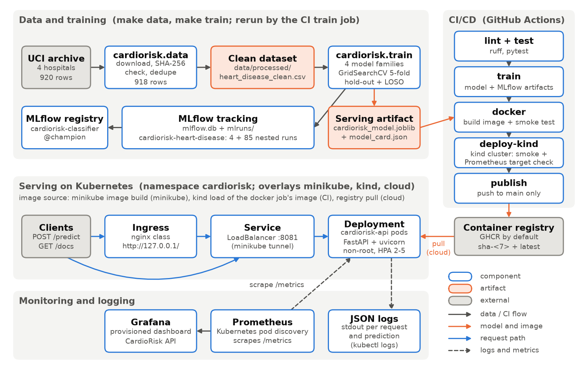

Figure 1 shows the four parts: data and training (checksummed data, grid search tracked in
MLflow, a serving artifact), CI/CD (retrain, test in Docker and kind, publish from `main`),
serving (FastAPI pods behind a LoadBalancer and an Ingress) and monitoring (Prometheus, Grafana,
JSON logs). Each concern has one code path: the cross-validated pipeline is the served object, the
API and the CLI share `predict_records`, and the tested image is the published one.

# 3. Setup and installation

Prerequisites: Python 3.12 and `make`; Docker for the container; minikube and kubectl for
Kubernetes; Google Chrome only for the PDF of this report.

```bash
make setup          # .venv with the pinned requirements.txt
make data           # verify (or download) the UCI files, write the cleaned CSV
make eda            # EDA figures in reports/figures/eda_*.png
make lint test      # ruff and the 39 unit tests, as in CI
make train          # tune, track in MLflow, save the champion (about 30 s)
make mlflow-ui      # MLflow UI on http://127.0.0.1:5001
make serve          # API on http://127.0.0.1:8081/docs
make docker-build docker-run   # then, in a second terminal: make smoke
make compose-up     # API + Prometheus :9090 + Grafana :3000 without Kubernetes
make minikube-start k8s-image k8s-deploy
make report report-pdf         # this report: reports/report.docx and .pdf
```

The API uses host port 8081 and MLflow 5001, because 8000, 8080 and 5000 are often taken;
`PORT=` and `MLFLOW_PORT=` change them. Every Kubernetes target runs `kubectl --context minikube`,
and `make k8s-deploy` stops if that context is missing. The README has the full command reference
and troubleshooting.

# 4. Data acquisition and EDA

## 4.1 Source and cleaning

The UCI Heart Disease dataset (id 45) ships one "processed" file per hospital with the same 14
attributes: Cleveland (303 rows), Hungary (294), Switzerland (123) and VA (200). `make data`
checks the files against SHA-256 digests pinned in `data.py` and downloads the archive only if one
is missing or differs, since a silently republished archive would shift every number here. Raw
files and the cleaned CSV are committed, so CI never depends on the UCI server. `clean()` applies
the rules in Table 2, each unit-tested. A `site` column is kept for stratification and
leave-one-site-out evaluation, never as an input.

*Table 2. Cleaning rules and how many values they touch.*

| Rule | Affected | Reason |
| ------------ | ------------ | ---------------- |
| `?` read as missing | 1,759 values | UCI marker for "not recorded" |
| `chol == 0` set to missing | 172 rows (all 123 Swiss, 49 VA) | Zero cholesterol is impossible: "not measured" |
| `trestbps == 0` set to missing | 1 row (VA) | Same reason |
| Exact duplicates dropped | 2 rows (1 Hungary, 1 VA) | A copy could land on both sides of the split |
| `target = (num > 0)` | all 918 rows | Hungary coded `num` only as 0/1, the others graded 1-4 |
| Kept: negative `oldpeak` (12 rows), extremes such as `chol = 603` | - | Clinically real, so no clipping |

Imputation is not cleaning: it is part of the model pipeline, fitted on training folds only.

## 4.2 Exploratory analysis

`make eda` draws the figures and `notebooks/01_eda.ipynb` discusses them; Figure 2 is here, the
others are in Appendix B. Each finding led to a pipeline decision.

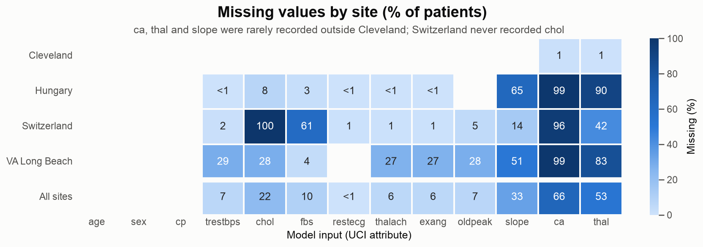

- **Missingness is structural (Figure 2).** `ca` is missing for 96-99% of patients outside
  Cleveland, `thal` for 42-90%, Switzerland never recorded cholesterol, and VA lacks 27-28% of its
  exercise-test values. Only 299 of 918 rows are complete (297 from Cleveland), so dropping
  incomplete rows would leave one hospital. Missingness is also informative: the hospital alone
  ranks patients with ROC-AUC 0.72, and the 35 missingness patterns identify the hospital for 86%
  of patients. Decision: impute with missing-value indicators, knowing they partly reconstruct the
  hospital (Section 5.5).
- **Class balance (Figure 11).** 508 patients (55%) have heart disease, so accuracy is meaningful
  and no resampling is needed, but the rate is 36% in Hungary, 46% in Cleveland, 74% at VA and 93%
  in Switzerland. Decision: stratify the split and folds on site x class.
- **Distributions and categories (Figures 12, 13).** The exercise-test variables separate the
  classes best (median maximum heart rate 151 vs 128 bpm, ST depression 0.0 vs 1.1 mm); scales
  differ by two orders of magnitude. Asymptomatic chest pain (`cp = 4`) has a 79% disease rate
  against 14% for atypical angina, the codes are not ordinal and "not recorded" has its own rate.
  Decision: standardise numeric inputs, one-hot encode categorical ones with missing as a category.
- **Correlations and heart rate (Figures 14, 15).** The strongest correlates of disease are
  exercise angina (r = 0.46), `oldpeak` (0.39) and `thalach` (-0.39); correlation among inputs
  peaks at 0.39, so no input is dropped by hand. 66% of patients with disease stay below 85% of the
  age-predicted maximum heart rate, against 40% of those without. Decision: add `hr_achieved_frac`.

# 5. Feature engineering and model development

## 5.1 The pipeline

Everything between a raw record and the classifier is one scikit-learn `Pipeline`
(`cardiorisk.features.build_pipeline`): (1) `features` keeps the 13 inputs as floats (JSON `null`
becomes NaN, extra columns are dropped) and adds `hr_achieved_frac = thalach / (220 - age)`;
(2) `preprocess` applies median imputation with missing-value indicators and `StandardScaler` to
numeric inputs, most-frequent imputation with indicators to binary ones, and
`OneHotEncoder(handle_unknown="ignore")` to categorical ones, with NaN as its own category;
(3) `model` is the estimator being tuned. `GridSearchCV` therefore refits imputers and scaler in
every fold (no leakage), and the saved object replays the training transforms, with no second copy
of the feature code in the API. The indicators also let the API score a record with only `age`,
`sex` and `cp`.

## 5.2 Candidates, validation and selection

*Table 3. Model families, their grids and number of candidates n (`train.CANDIDATES`).*

| Family (fixed settings) | Grid | n |
| ---------------- | ---------------------------------- | -- |
| Majority baseline (`DummyClassifier`) | none | 1 |
| Logistic regression (`saga`, `max_iter=5000`) | `C` {0.01, 0.03, 0.1, 0.3, 1, 3} x `l1_ratio` {0, 0.5, 1} x `class_weight` {None, balanced} | 36 |
| Random forest (`random_state=42`) | `n_estimators` {200, 500} x `max_depth` {4, 8, None} x `min_samples_leaf` {1, 3, 10} x `max_features` {sqrt, 0.5} | 36 |
| Hist. gradient boosting (`max_iter=200`) | `learning_rate` {0.03, 0.1} x `max_leaf_nodes` {4, 8, 16} x `l2_regularization` {0, 1} | 12 |

An 80/20 split stratified on site x class gives 734 training and 184 test patients. Five folds of
the training split on the same strata are shared by all families, so the comparison is paired.
Every fold records ROC-AUC, accuracy, precision, recall and F1 at threshold 0.5. The champion is
the non-baseline family with the highest mean CV ROC-AUC, which is threshold-free and insensitive
to prevalence; the hold-out is scored once per family, for reporting only. The grids are coarse on
purpose: the CV standard deviation is 0.023-0.035 ROC-AUC, while the 18 logistic-regression
candidates with `C >= 0.3` span only 0.0029, so a finer grid would select noise.

## 5.3 Results

*Table 4. Model comparison (from `reports/metrics.md`; CV = mean over 5 folds).*

| Metric | Baseline | Logistic regression (champion) | Random forest | Hist. gradient boosting |
| ---- | ---- | ---- | ---- | ---- |
| CV ROC-AUC | 0.500 ± 0.000 | **0.907 ± 0.029** | 0.897 ± 0.023 | 0.895 ± 0.026 |
| CV accuracy | 0.553 | 0.834 | 0.823 | 0.811 |
| CV precision | 0.553 | 0.853 | 0.829 | 0.815 |
| CV recall | 1.000 | 0.845 | 0.857 | 0.852 |
| CV F1 | 0.712 | 0.849 | 0.843 | 0.833 |
| Test ROC-AUC | 0.500 | 0.906 | 0.896 | 0.900 |
| Test accuracy | 0.554 | 0.842 | 0.853 | 0.853 |
| Test precision | 0.554 | 0.829 | 0.844 | 0.844 |
| Test recall | 1.000 | 0.902 | 0.902 | 0.902 |
| Test F1 | 0.713 | 0.864 | 0.872 | 0.872 |

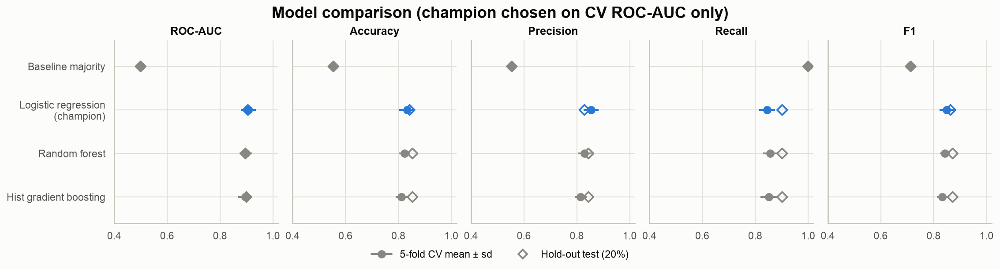

Best settings: logistic regression `C = 0.3`, `l1_ratio = 0.5`, no class weight; forest 500 trees
of depth 8; boosting learning rate 0.03 with 4 leaves. All three beat the baseline by about 0.40
ROC-AUC, and CV and hold-out agree within 0.01 (Figure 3), so none is overfitted to the folds.

**Why logistic regression.** It leads on CV ROC-AUC by 0.010-0.012, less than one standard
deviation, so the three are statistically tied and the linear model wins on its merits. Boosting's
best configuration used the smallest trees on offer, a sign that extra capacity fits noise at 734
patients; one-hot categories and indicators make the signal close to additive; and the pipeline
needs about 205 MiB per pod against 240 MiB for the forest, with coefficients a clinician can read.
The ensembles' higher hold-out accuracy (0.853 vs 0.842) is two patients; switching for it would
select on the test set.

## 5.4 The champion on the hold-out set

|   |   |
| --- | --- |
| 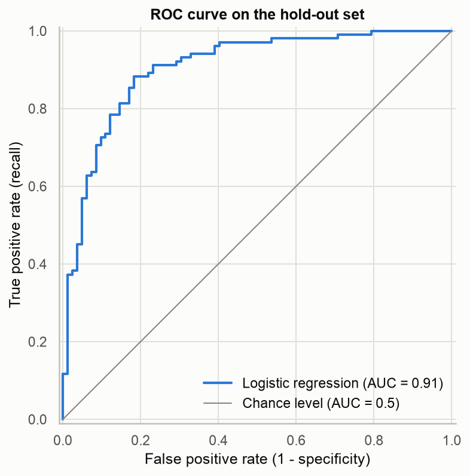 | 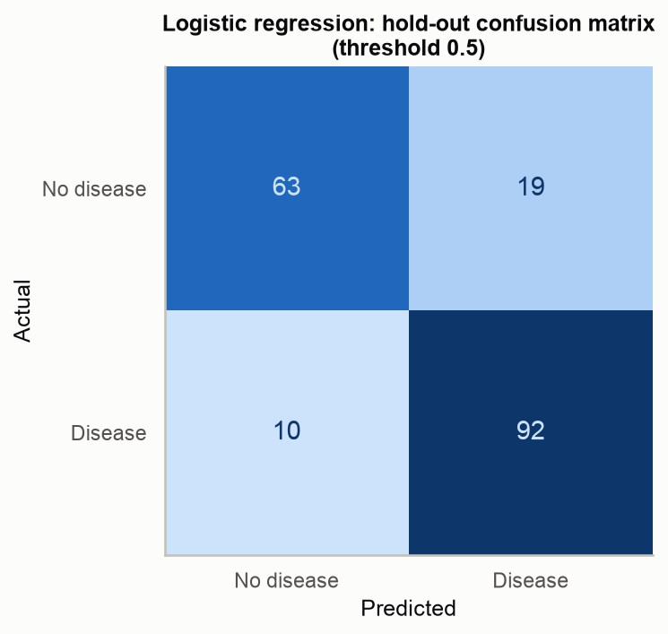 |
| *Figure 4. ROC curve on the 184 hold-out patients.* | *Figure 5. Hold-out confusion matrix at threshold 0.5.* |

The ROC curve (Figure 4) finds about 80% of disease cases at a 15% false-positive rate. At 0.5
(Figure 5) the model finds 92 of 102 patients with disease (recall 0.902) and clears 63 of 82
without (specificity 0.768): 19 false alarms and 10 missed cases, the right direction for
screening. Permutation importance (Figure 16, Appendix B) is led by chest pain type (0.051 ROC-AUC
lost), then `ca` (0.018) and `oldpeak` (0.014). `chol` ranks fourth (0.013) despite a correlation
of 0.12 because it mostly signals whether cholesterol was measured: shuffling only the recorded
values costs about 0.002.

## 5.5 Leave-one-site-out: how well does the model travel?

Pooled CV mixes all hospitals in every fold. To estimate performance at a new hospital, training
refits the champion configuration on three sites and scores it on the fourth (Table 5; chart in
Figure 17, Appendix B).

*Table 5. Leave-one-site-out results of the champion configuration.*

| Held-out site | Patients | Disease | ROC-AUC | Accuracy | Recall |
| --- | --- | --- | --- | --- | --- |
| Cleveland | 303 | 46% | 0.876 | 0.762 | 0.878 |
| Hungary | 293 | 36% | 0.902 | 0.795 | 0.906 |
| Switzerland | 123 | 93% | 0.749 | 0.772 | 0.791 |
| VA Long Beach | 199 | 74% | 0.730 | 0.759 | 0.831 |

Transfer to the two lower-prevalence hospitals is almost as good as the pooled hold-out (0.876 and
0.902 against 0.906), but at Switzerland and VA ROC-AUC falls to about 0.74. Both have high
prevalence and the most missing data, a signal a model trained elsewhere reads differently.
Accuracy hides the drop: calling every patient diseased would already score 0.74 at VA and 0.93 in
Switzerland. The hyper-parameters were chosen by CV over all four sites, so these scores are
mildly optimistic; at a new hospital I would expect 0.73-0.90 until the model is validated
locally. These metrics are also in the model card, MLflow and `/model-info`.

# 6. Experiment tracking

MLflow 3.16 tracks every training session in the experiment `cardiorisk-heart-disease`, with a
sqlite backend (the registry needs a database) and artifacts under `mlruns/`; CI uploads both as
the `mlflow-tracking` artifact. Each session logs four family runs, tagged with `training_session`
and `family`, holding the estimator parameters, `cv_<metric>_mean/std` and `test_<metric>` for the
five metrics, the training split as an MLflow dataset (734 rows, with digest), plots (ROC,
precision-recall, confusion matrix, permutation importance), `cv_results.csv`, a classification
report and the model. Under them, 85 nested runs (1 + 36 + 36 + 12), one per grid point, hold the
hyper-parameters, CV mean and sd, `fit_seconds` and per-fold scores (`cv_folds.json`). The
champion run adds the tag `champion = true`, the `loso_<site>_*` metrics and the leave-one-site-out
plot, and registers a new version of `cardiorisk-classifier` with the alias `champion`.

Nested runs keep the top-level list at four rows while recording every grid point (Figures
18-21, Appendix C). The registry uses an alias instead of the stages MLflow 3 deprecates; moving
`@champion` is the promotion step. `model_card.json` and `/health` report the registry version.

# 7. Model packaging and reproducibility

**Serving artifact.** `models/cardiorisk_model.joblib` is the fitted pipeline scored on the
hold-out; `models/model_card.json` records registry version, hyper-parameters, threshold, metrics,
features, MLflow run id, library versions and the SHA-256 of the cleaned table. joblib keeps MLflow
out of the image; it can execute code on load, acceptable only because the file comes from the
project's own training job and is never accepted from users.

**MLflow model.** Each family run also logs the model with **skops**, which refuses any type not
explicitly trusted; `code_paths` bundles `src/cardiorisk`, so
`models:/cardiorisk-classifier@champion` loads without the package.

**Requirements and determinism.** Both requirement files pin exact versions:
`requirements-serve.txt` holds the nine runtime packages the image installs, and
`requirements.txt` adds the training and development tools. One seed (42) drives split, folds,
estimators and permutation importance, so `make train` reproduces every metric.

# 8. CI/CD pipeline and automated testing

**Tests.** 39 pytest tests run offline in about 20 s on synthetic patients, plus one gate on the
real data. They cover every cleaning rule and the checksum-verified download, the feature formula
and a pickle round trip, the CLI, every API contract (null and omitted fields, 422 without echoed
values, `X-Request-ID`, the Prometheus series, JSON logs without patient data) and a reduced
`train()` that must write the card, reports, MLflow runs and alias, with logistic regression
reaching CV ROC-AUC >= 0.80 on the real data.

**Workflow.** `.github/workflows/ci.yml` runs on every push to `main`, every pull request and on
demand, with six jobs (Figure 6): `lint` (ruff) and `test` (pytest, JUnit XML) in parallel;
`train` (data check and full training, model comparison in the run summary, Figure 7); `docker`
(builds the image around this run's model, smoke test); `deploy-kind` (a kind cluster with the
tested image and the kind overlay, smoke test through the Service, waits until Prometheus reports
every API target up); and `publish`.

**Gating and publishing.** Each job runs only if its predecessors passed, so nothing untested is
published; failing jobs print container logs or the cluster's pods and events. On a
push to `main`, `publish` tags the image archive that passed both smoke tests `sha-<7>` and
`latest` and pushes it without rebuilding, to GHCR with `GITHUB_TOKEN` by default; repository
variables and one secret redirect it to Docker Hub, ECR, GAR or ACR.

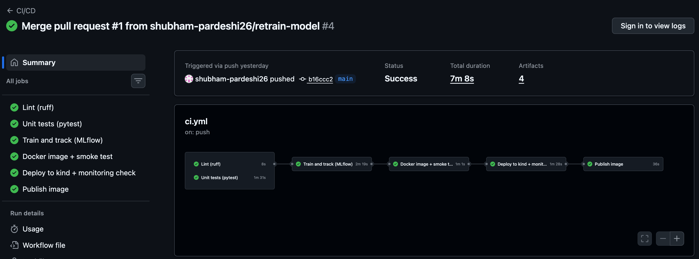

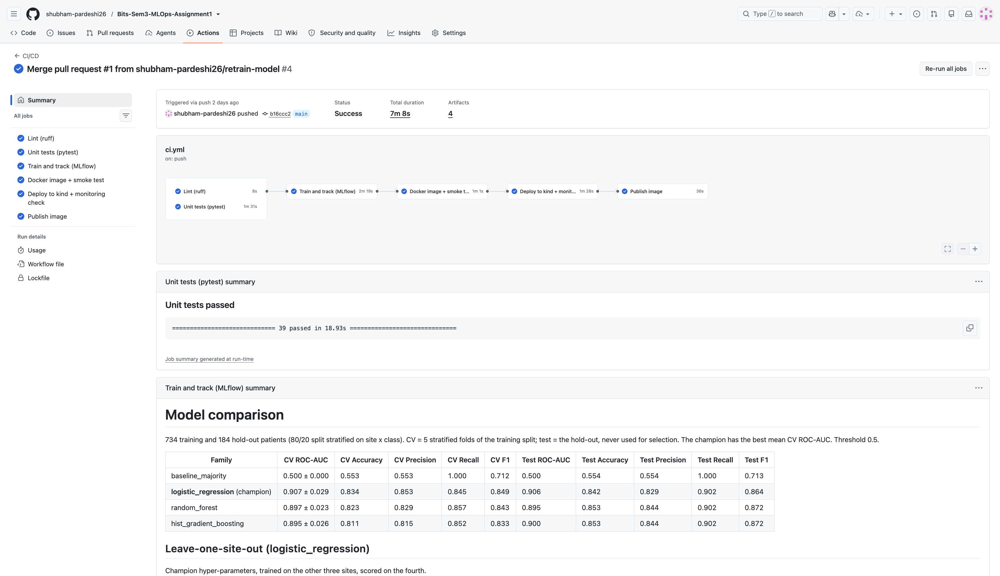

# 9. Model containerization

The `Dockerfile` builds on `python:3.12-slim` with only `requirements-serve.txt`, and
`.dockerignore` is an allowlist (`requirements-serve.txt`, `src/`, `models/`). Requirements are
installed before code and model are copied, so a retrain rebuilds only the last layers. The model
is baked in, so one tag identifies code and model. The app runs as uid 10001 with read-only files
and a `HEALTHCHECK` on `/health`.

The API (`cardiorisk.api:app`, container port 8000) has five endpoints: `POST /predict`, `GET
/health` (liveness and readiness, with the model version), `GET /model-info` (the model card),
`GET /metrics` (Prometheus) and `GET /docs` (Swagger UI, prefilled with the sample patient):

```bash
curl -s -X POST http://127.0.0.1:8081/predict \
  -H 'Content-Type: application/json' -d @scripts/sample_request.json
# {"prediction": 1, "label": "heart_disease", "confidence": 0.9851,
#  "probability_disease": 0.9851, "model_version": "3"}
```

Pydantic rejects codes outside the UCI codebook, implausible measurements and unknown fields, so a
misspelt field cannot silently become a missing value; only `age`, `sex` and `cp` are required, and
the 422 response does not echo the submitted values. `make docker-build`, `make docker-run` and
`make smoke` prove the image (Figures 24, 25, Appendix C): the smoke test checks `/health`, the
response contract, 422 for invalid payloads and `/metrics`.

# 10. Production deployment

The manifests use Kustomize. `base/` holds the namespace `cardiorisk`, the Deployment, a ClusterIP
Service and the HPA; `monitoring/` adds Prometheus (with a namespaced Role) and Grafana. Three
overlays adapt them: `minikube` (image built inside minikube, LoadBalancer on port 8081, nginx
Ingress), `kind` (the CI deployment test) and `cloud` (registry image, LoadBalancer and Ingress,
notes for GKE, EKS and AKS).

The HPA owns the replica count (2-5 at 70% CPU). Rolling updates keep every ready pod until its
replacement is ready (`maxUnavailable: 0`), and all probes use `/health`. Memory is sized from a
measured 205 MiB peak (256 MiB request, 512 MiB limit). The namespace enforces the `restricted` Pod
Security Standard (non-root, read-only root filesystem, no capabilities).

The deployment in the screenshots runs on minikube with the Docker driver: `make minikube-start`
(ingress and metrics-server addons), `make k8s-image` (builds the image inside minikube, so no
registry is needed), `make k8s-deploy` (`kubectl --context minikube apply -k
deploy/k8s/overlays/minikube`), then `minikube tunnel` in a separate terminal, `make smoke` against
the LoadBalancer and `make smoke URL=http://127.0.0.1` against the Ingress (Figures 8, 9).
For a managed cluster only the lines in `overlays/cloud` (image, Ingress class) change.


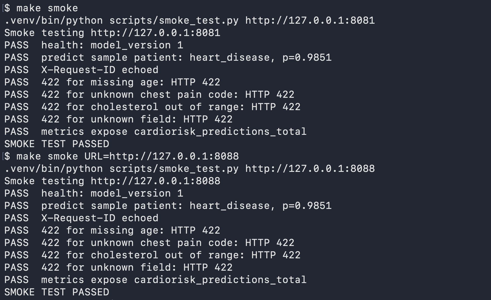

# 11. Monitoring and logging

**Metrics.** The API exports `cardiorisk_http_requests_total` (by method, route and status) and
`cardiorisk_http_request_duration_seconds` for traffic, errors and latency;
`cardiorisk_predictions_total` by label and `cardiorisk_prediction_probability` (a coarse drift
signal) for the predictions; and `cardiorisk_model_info` with the version each pod serves. The
`route` label is the route template, so random URLs cannot create unbounded series. Prometheus
discovers annotated pods and scrapes every 5 s (Figure 26, Appendix C). Grafana is provisioned from
ConfigMaps; the "CardioRisk API" dashboard (Figure 10) shows pods up, model version, prediction
mix, request rate, error share, `/predict` latency p50/p95/p99, memory and the predicted-probability
distribution. `make load` sends 300 varied requests, 10% invalid, so every panel has data.

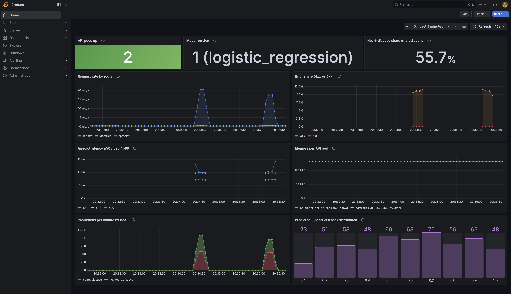

**Logs.** Every request writes one JSON line to stdout (`event`, `request_id`, `method`, `route`,
`status`, `duration_ms`) and every prediction one more (`label`, `probability_disease`,
`model_version`), joined by the request id: the caller's `X-Request-ID` or a generated one
(Figure 27, Appendix C). Probes and scrapes are logged at DEBUG, so the INFO log shows real
traffic. Patient features are never logged, which a test enforces.

# 12. Limitations and future work

- **Hospital shift.** Leave-one-site-out ROC-AUC drops to 0.73-0.75 at the two high-prevalence
  sites, and part of the pooled score comes from recognising a hospital by its missing tests. Next:
  train without missing-value indicators and compare, and tune by nested leave-one-site-out CV.
- **Calibration and threshold.** Probabilities fitted to the pooled 55% mix are likely off at 93%
  and 36% sites; training should report the Brier score, sites should recalibrate, and the 0.5
  threshold should come from a recall target agreed with clinicians.
- **Drift.** The probability histogram is a coarse proxy; per-input distributions and missing
  rates should be compared with the training data, and confirmed diagnoses collected.
- **Data and tracking.** Checksum pinning suits a static dataset; a growing one needs DVC or
  remote MLflow storage and a shared tracking server.
- **Security and operations.** No authentication, TLS or rate limiting (coursework, not a medical
  device); Prometheus data lives on an `emptyDir`, and the HPA scales on CPU only.

# Appendix A. Repository structure

```text
.
├── src/cardiorisk/          config, data, eda, features, train, predict, api
├── test/                    pytest suite (39 tests) and conftest.py
├── notebooks/01_eda.ipynb   EDA with commentary
├── scripts/                 smoke test, sample request, architecture diagram
├── data/raw/                four UCI site files + codebook (SHA-256 pinned)
├── data/processed/          heart_disease_clean.csv (918 rows)
├── models/                  cardiorisk_model.joblib, model_card.json
├── reports/                 REPORT.md, report.docx/.pdf, metrics.*, figures/
├── screenshots/             evidence for this report (01-15)
├── deploy/k8s/              base/, monitoring/, overlays/{minikube,kind,cloud}/
├── deploy/compose/          prometheus.yml for docker-compose
├── .github/workflows/       ci.yml
├── Dockerfile, .dockerignore, docker-compose.yml, Makefile
└── pyproject.toml, requirements.txt, requirements-serve.txt
```

The command reference (every `make` target and variable) is in `README.md` and `make help`.

# Appendix B. Additional figures

The EDA figures of Section 4.2 (larger and with commentary in `notebooks/01_eda.ipynb`), the
champion's permutation importance (Section 5.4) and the leave-one-site-out chart (Section 5.5).

|   |   |
| --- | --- |
| 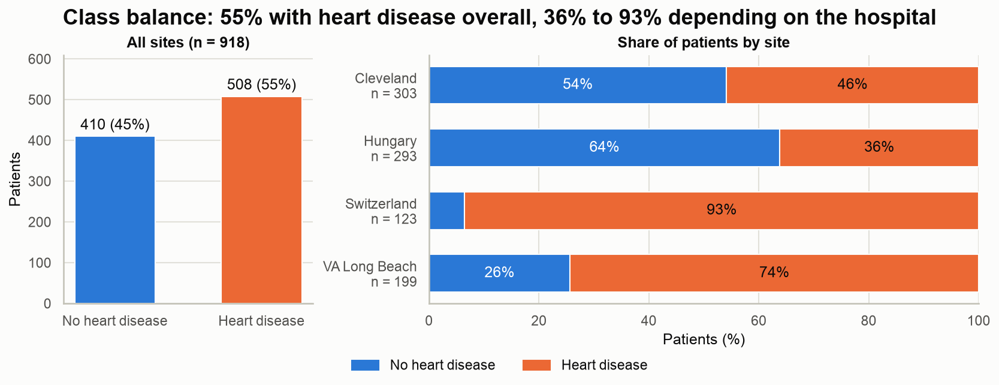 | 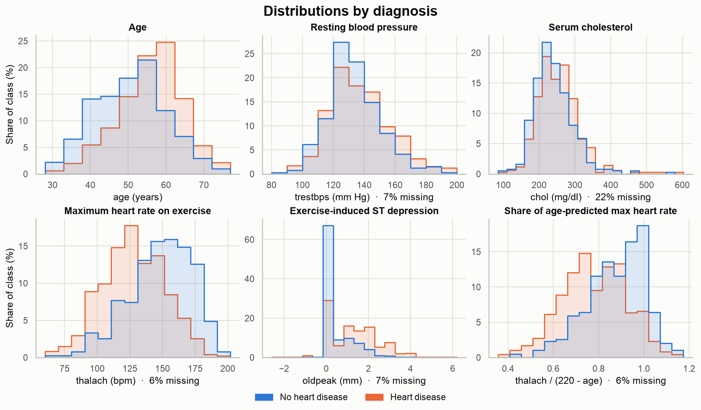 |
| *Figure 11. Class balance overall and by hospital.* | *Figure 12. Numeric inputs by diagnosis.* |
| 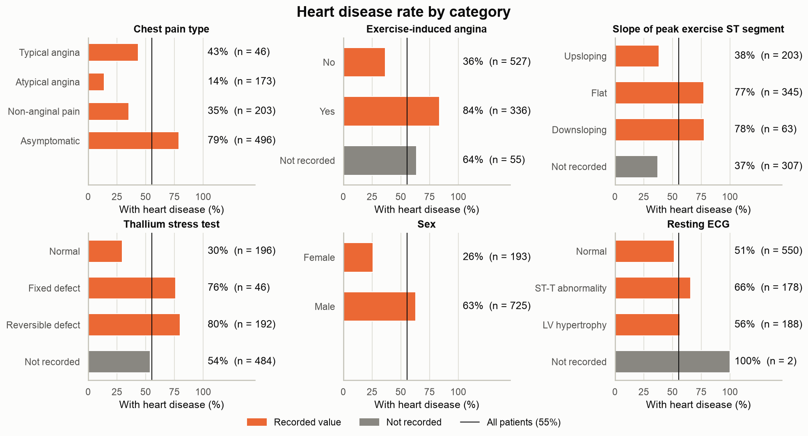 | 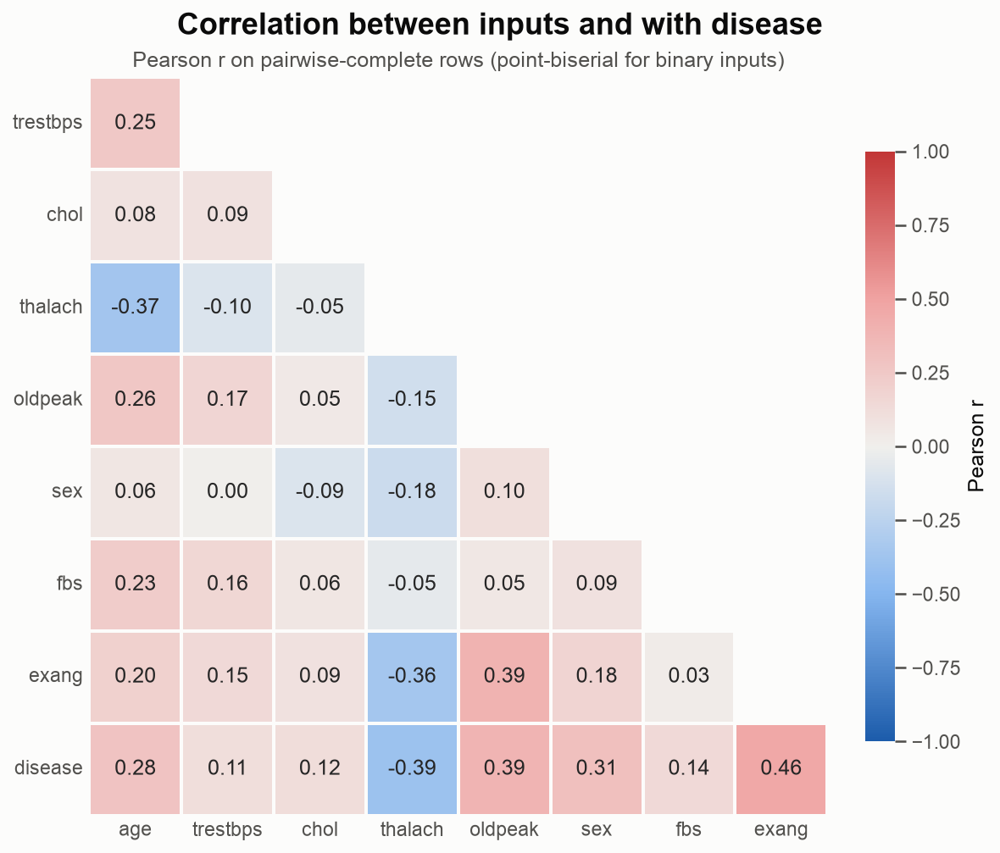 |
| *Figure 13. Disease rate per category, "not recorded" as its own bar.* | *Figure 14. Pearson correlations between the inputs and with disease.* |
| 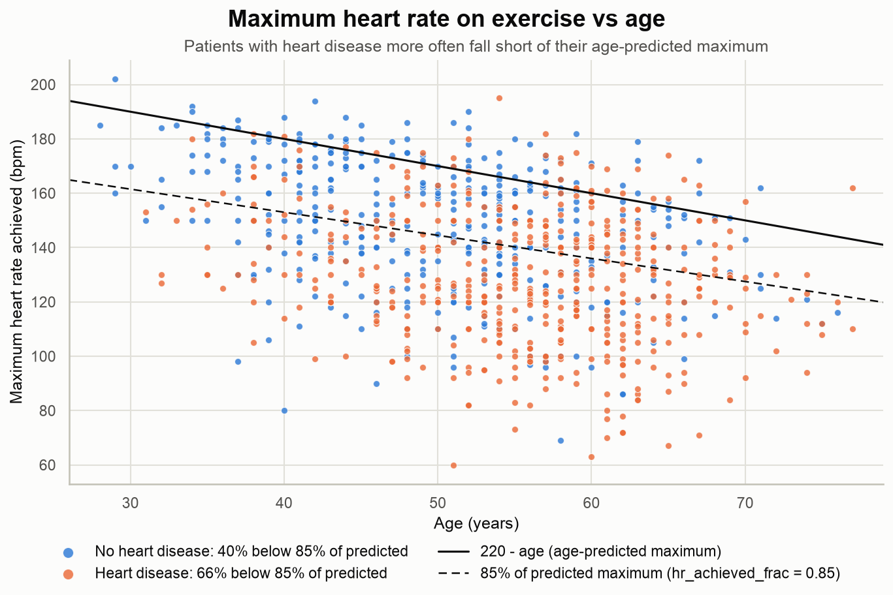 | 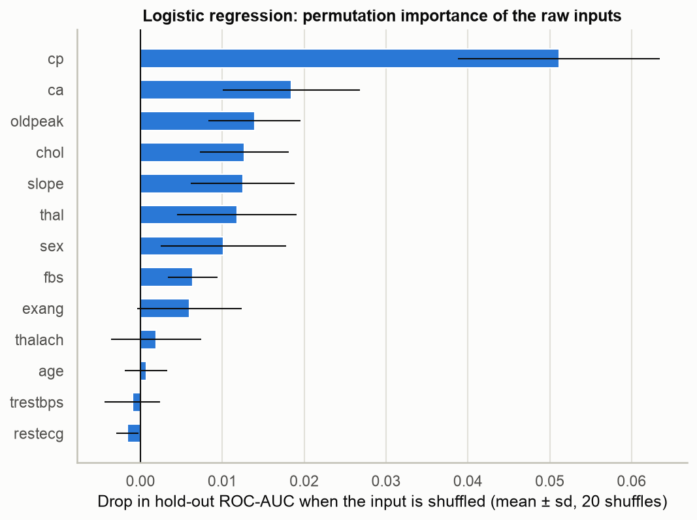 |
| *Figure 15. Maximum heart rate against age, with the line 220 - age.* | *Figure 16. Permutation importance on the hold-out (20 shuffles).* |

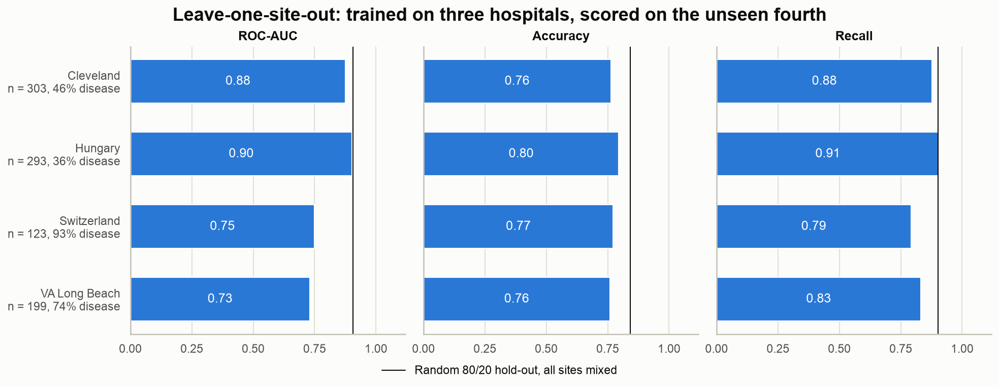

# Appendix C. Additional screenshots

|   |   |
| --- | --- |
| 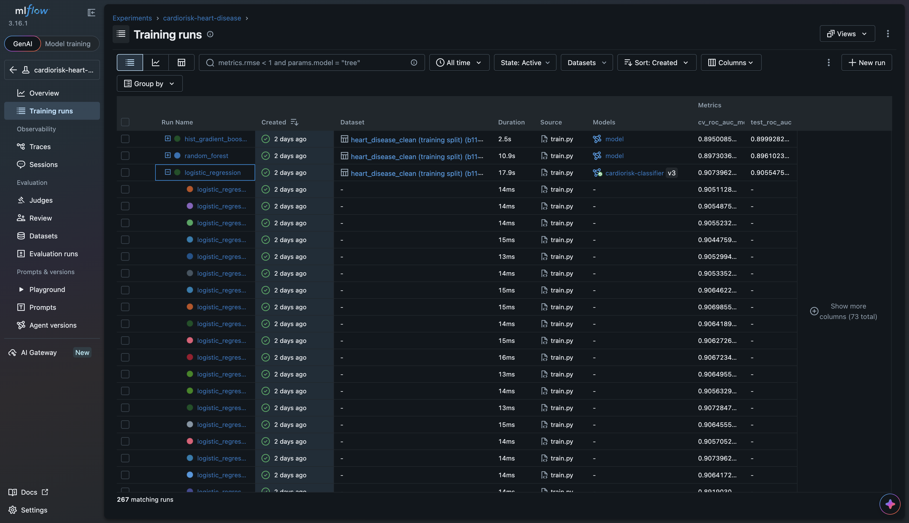 |  |
| *Figure 18. MLflow experiment: the four family runs of a session.* | *Figure 19. MLflow champion run: parameters, metrics, `plots/`.* |
| 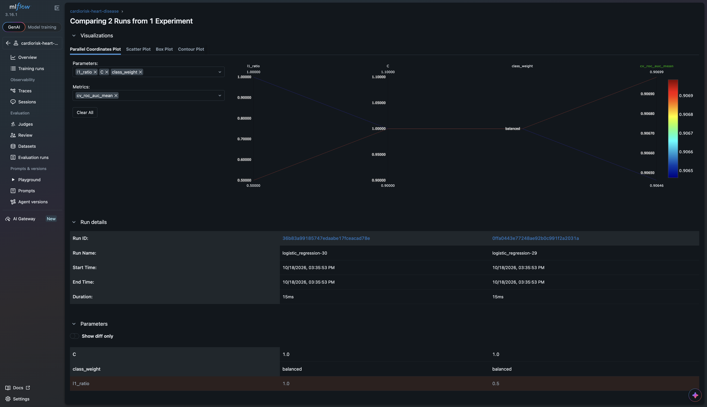 | 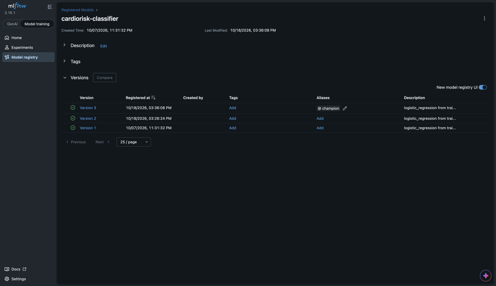 |
| *Figure 20. Compare view of the 36 nested logistic-regression runs.* | *Figure 21. Registry: `cardiorisk-classifier@champion`.* |
| 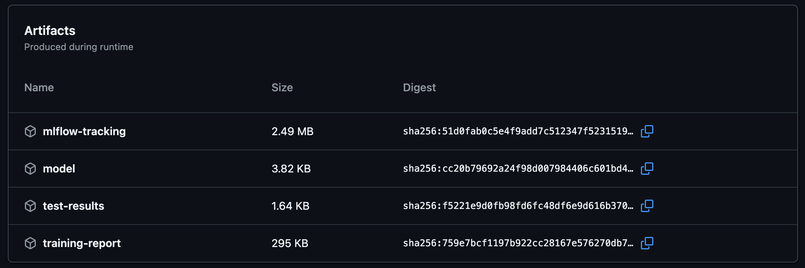 | 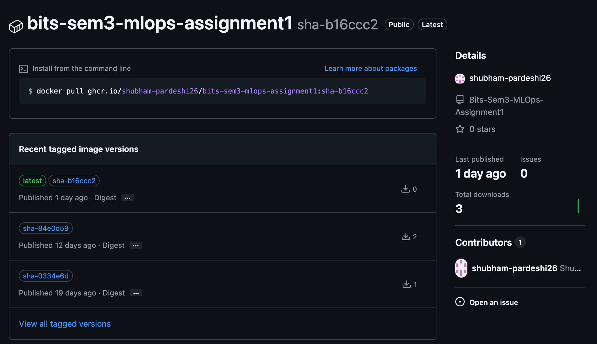 |
| *Figure 22. Artifacts of the workflow run.* | *Figure 23. GHCR package, tags `sha-<7>` and `latest`.* |
| 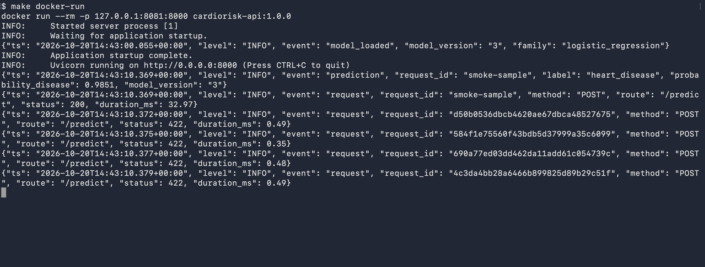 | 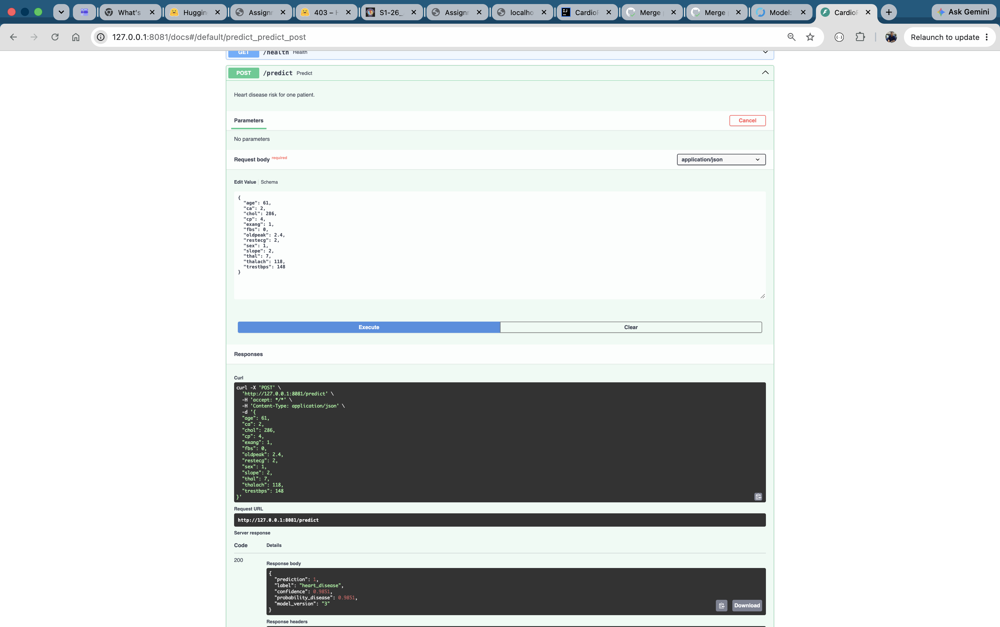 |
| *Figure 24. `make docker-build`, `docker-run` and `smoke` passing.* | *Figure 25. Swagger UI: a `/predict` request and response.* |
| 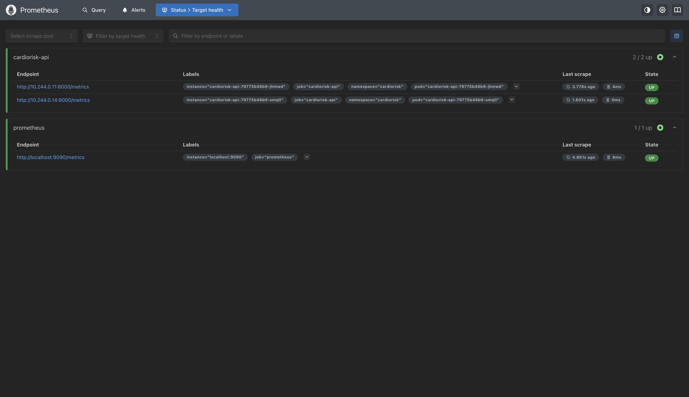 | 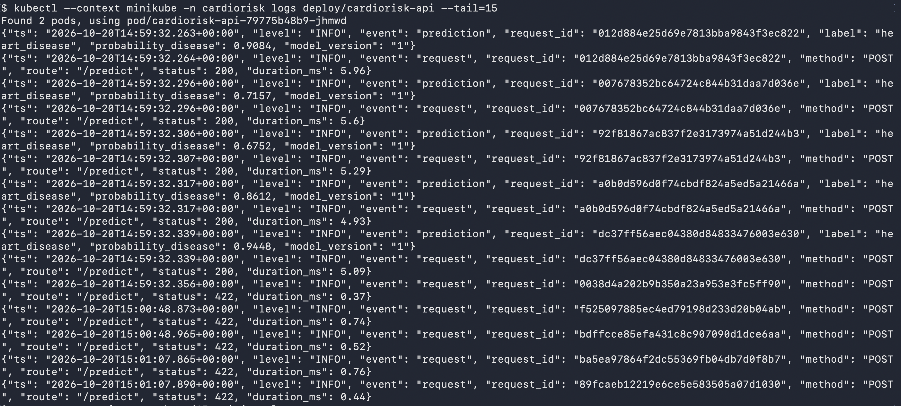 |
| *Figure 26. Prometheus: `cardiorisk-api` pod targets UP.* | *Figure 27. `kubectl logs`: JSON request and prediction lines.* |
